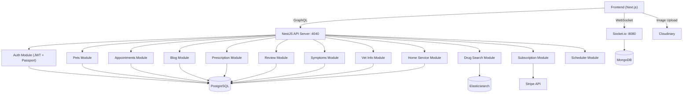

# 🐾 WhiskerDoc — Backend

Backend API server for **WhiskerDoc**, a pet healthcare platform that connects pet owners with licensed veterinarians for online and in-person appointments.

🔗 **Frontend:** [whisker_doc_frontend](https://github.com/mehedi-imam241/whisker_doc_frontend)

**Tech Stack:** NestJS · GraphQL (Apollo) · MongoDB (Mongoose) · PostgreSQL (TypeORM) · Elasticsearch · Socket.io · Stripe · JWT Auth · Docker

---

## 🏗️ Architecture



### Data Storage Strategy
| Database | Used For |
|----------|----------|
| **PostgreSQL** | Users, pets, appointments, blogs, prescriptions, reviews, symptoms, vet info, home service |
| **MongoDB** | Chat messages, vet review aggregations |
| **Elasticsearch** | Drug search with fuzzy matching |
| **Cloudinary** | Avatar and image uploads (user, pet, vet) |
| **Stripe** | Subscription plans and payment processing |

---

## ✨ API Modules

| Module | Description |
|--------|-------------|
| **Auth** | JWT-based authentication with role-based access (USER, VET, ADMIN, PARAVET) |
| **Pets** | CRUD operations for pet profiles (species, breed, age, weight) |
| **Appointments** | Book online/in-person appointments, manage time slots, cancel bookings |
| **Prescription** | Vets create prescriptions with symptoms, diseases, medicines, and advice |
| **Blog** | CRUD blog posts with rich text content |
| **Review** | Users rate and review vets after appointments |
| **Symptoms** | Vets write symptom articles; admins verify them; tag-based search |
| **Drug Search** | Elasticsearch-powered drug lookup with fuzzy matching |
| **Subscription** | Stripe integration for subscription plans |
| **Chat** | Real-time messaging via Socket.io |
| **Home Service** | Vets offer home visit services with date/slot scheduling |
| **Vet Info** | Vet profiles with location (lat/lng), degree, ratings, Zoom link |
| **Scheduler** | Cron-based background tasks |

---

## 🚀 Getting Started

### Prerequisites
- Docker & Docker Compose

### Run with Docker

```bash
# Clone the repository
git clone https://github.com/mehedi-imam241/whisker_doc_backend.git
cd whisker_doc_backend

# Set your Stripe key
export STRIPE_API_SECRET_KEY=sk_test_your_key

# Start all services (MongoDB, PostgreSQL, Elasticsearch, Kibana, Backend)
docker compose up -d --build

# View logs
docker logs -f whisker_doc_backend
```

### Services & Ports

| Service | Port | Description |
|---------|------|-------------|
| Backend API | `4040` | GraphQL endpoint at `/graphql` |
| WebSocket | `4041` | Socket.io for real-time chat |
| MongoDB | `4042` | Document database |
| Elasticsearch | `4043` | Search engine |
| Kibana | `4044` | ES dashboard |
| PostgreSQL | `4045` | Relational database |

### Run without Docker

```bash
npm install --legacy-peer-deps
npm run start:dev
```

> Requires MongoDB, PostgreSQL, and Elasticsearch running locally. Set connection details via environment variables.

### Environment Variables

| Variable | Description |
|----------|-------------|
| `JWT_SECRET` | Secret key for JWT token signing |
| `PORT` | API server port (default: 4040) |
| `SOCKET_PORT` | WebSocket port (default: 8080) |
| `DB_HOST` | MongoDB connection URL |
| `DB_NAME` | MongoDB database name |
| `POSTGRES_USER` | PostgreSQL username |
| `POSTGRES_PASSWORD` | PostgreSQL password |
| `POSTGRES_DB` | PostgreSQL database name |
| `POSTGRES_HOST` | PostgreSQL host |
| `POSTGRES_PORT` | PostgreSQL port |
| `ELASTICSEARCH_NODE` | Elasticsearch URL |
| `STRIPE_API_SECRET_KEY` | Stripe secret key for subscriptions |

